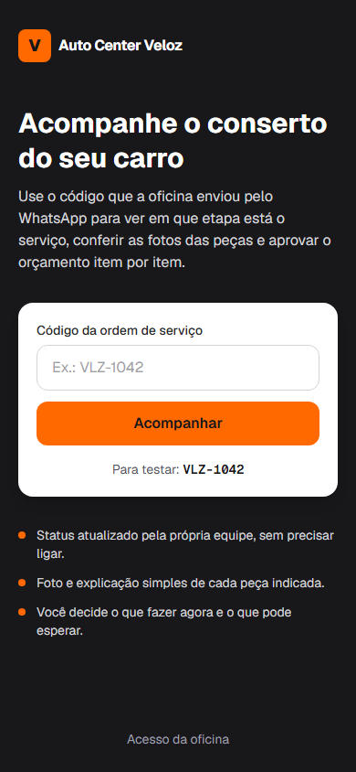
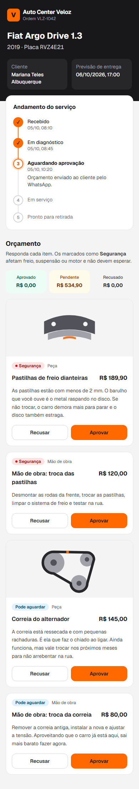
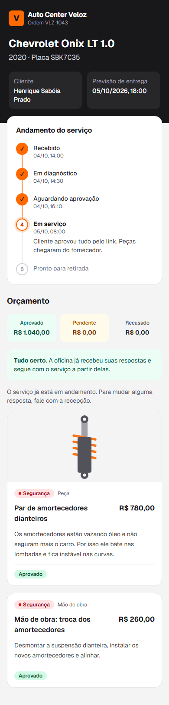
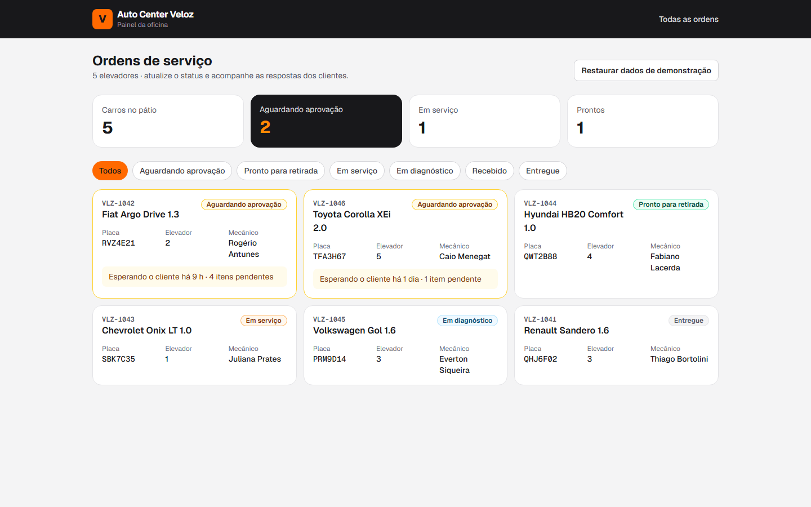
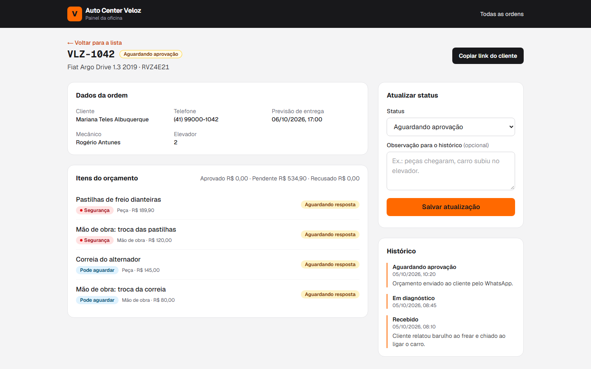

# Auto Center Veloz

Web app em que o cliente da oficina acompanha o conserto do carro e aprova o orçamento item por item, e a equipe atualiza o status por um painel.

Deploy: (link será adicionado após a publicação)

Licença: MIT

## Briefing do problema

A Auto Center Veloz é uma oficina com 5 elevadores, 6 mecânicos e 2 recepcionistas. O orçamento ainda é impresso e a aprovação das peças é feita por telefone.

Na prática, isso gera três problemas:

- **Telefone tocando o dia inteiro.** Os clientes ligam para saber em que pé está o conserto e pedem fotos das peças com defeito. A recepção não tem a resposta e precisa ir até o mecânico.
- **Mecânico parado.** Cada pergunta da recepção interrompe o serviço que está no elevador.
- **Aprovação lenta.** Entre explicar o orçamento por telefone, o cliente pensar e ligar de volta, passam horas. Enquanto isso o carro ocupa o elevador ou fica parado no pátio, que vive lotado.

O resultado é menos carros atendidos por dia e clientes inseguros, que aprovam sem entender ou recusam por desconfiança.

Concessionárias já oferecem relatório digital com fotos, mas cobram caro pela revisão. A Veloz já tem a confiança técnica dos clientes. O que falta é um canal de comunicação que mostre o que o mecânico viu, explique em linguagem simples e deixe o cliente decidir sem precisar ligar.

## Por que um web app

| Opção | Prós | Contras | Decisão |
| --- | --- | --- | --- |
| App nativo (Android/iOS) | Notificações push, acesso à câmera | O cliente precisa baixar um app que vai usar duas ou três vezes por ano. Duas lojas para publicar e manter | Descartado |
| Site institucional | Barato, fácil de manter | Só mostra informação fixa. Não resolve status nem aprovação | Descartado |
| Dashboard só interno | Organiza o pátio para a equipe | O cliente continua ligando, porque não enxerga nada | Descartado |
| Web app (link para o cliente + painel para a oficina) | Abre direto do WhatsApp, sem instalar nada. Um único código atende cliente e equipe | Sem push nativo; o aviso depende do WhatsApp | **Escolhido** |

O ponto central: ninguém instala app de oficina que usa poucas vezes por ano. Um link enviado pelo WhatsApp abre direto no navegador do celular, e é ali que o cliente já conversa com a oficina.

## Telas

| Início | Orçamento do cliente | Status do serviço |
| --- | --- | --- |
|  |  |  |
| O cliente digita o código recebido. | Cada item tem foto, explicação e resposta própria. | Linha do tempo com a etapa atual em destaque. |

**Painel da oficina:** resumo do pátio, filtro por status e tempo de espera das aprovações.



**Detalhe da ordem:** atualização de status, respostas do cliente e histórico.



## Funcionalidades

### Lado do cliente

- **Acompanhamento pelo código da ordem.** O cliente abre o link e vê a etapa atual. Resolve as ligações perguntando o status.
- **Linha do tempo** (recebido, diagnóstico, aguardando aprovação, em serviço, pronto) com data e hora de cada etapa concluída e a observação mais recente.
- **Foto e justificativa de cada item** em linguagem de leigo. Resolve os pedidos de foto por telefone e a desconfiança sobre a troca.
- **Selo "Segurança" ou "Pode aguardar"** em cada item, para o cliente separar o que é urgente do que pode ficar para depois.
- **Aprovação item por item**, com opção de alterar a resposta enquanto o serviço não começou. Substitui a ligação de aprovação e reduz o tempo do carro parado.
- **Resumo do orçamento** com totais aprovado, pendente e recusado.
- **Confirmação** quando todas as respostas foram enviadas.

### Lado da oficina

- **Cards de resumo:** carros no pátio, aguardando aprovação, em serviço e prontos. Dá uma visão rápida da lotação.
- **Filtro por status** e lista com placa, elevador e mecânico de cada carro.
- **Tempo de espera das aprovações** ("há 9 h") e quantidade de itens pendentes. A recepção sabe quem cobrar primeiro.
- **Atualização de status com observação**, que entra no histórico e aparece para o cliente. O mecânico atualiza uma vez e não precisa responder a recepção a cada ligação.
- **Respostas do cliente por item**, sem precisar anotar o que foi dito ao telefone.
- **Botão "Copiar link do cliente"** para colar no WhatsApp.
- **Histórico completo** da ordem.
- **Restaurar dados de demonstração**, útil para apresentar o projeto.

## Arquitetura

### Stack

- Next.js (App Router) com TypeScript
- Tailwind CSS
- Estado global com React Context e persistência em `localStorage`
- Sem bibliotecas de UI ou dependências além das que vêm com o `create-next-app`

### Estrutura de pastas

```
src/
  app/
    page.tsx                  início (busca pelo código)
    acompanhar/[codigo]/      tela do cliente
    painel/                   lista de ordens da oficina
    painel/[codigo]/          detalhe e atualização da ordem
  components/                 LinhaDoTempo, ItemOrcamento, ResumoOrcamento, CardOrdem, BadgeStatus...
  context/OrdensContext.tsx   estado das ordens e persistência
  data/ordens.ts              ordens fictícias da demonstração
  hooks/useAgora.ts           hora atual para o tempo de espera
  lib/                        formatadores e cálculos do orçamento
  types/ordem.ts              tipos de domínio
public/pecas/                 ilustrações das peças
docs/telas/                   prints usados neste README
```

### Fluxo

1. A recepção abre a ordem de serviço.
2. O mecânico faz o diagnóstico e lança os itens com foto e justificativa.
3. O cliente recebe o link pelo WhatsApp e aprova ou recusa cada item.
4. O painel mostra a resposta para a recepção e para o mecânico.
5. O serviço é executado e o status é atualizado até o carro ficar pronto.

### Dados mockados nesta versão

Esta versão não tem backend. As ordens vêm de `src/data/ordens.ts` e as alterações ficam salvas no `localStorage` do navegador. Isso permite demonstrar o fluxo completo sem servidor nem banco de dados.

A limitação é que as respostas só aparecem no painel quando cliente e oficina usam o mesmo navegador. Para testar, aprove itens em `/acompanhar/VLZ-1042` e depois abra `/painel/VLZ-1042` na mesma janela.

### Próximos passos para produção

- API em Node.js com Express para centralizar as ordens.
- Banco PostgreSQL para ordens, itens e histórico.
- Autenticação no painel, com acesso separado para recepção e mecânicos.
- Envio automático do link pelo WhatsApp Business API quando o orçamento ficar pronto.
- Armazenamento das fotos reais em S3, com upload direto do celular do mecânico.

## Como executar

Pré-requisito: Node.js 20 ou superior.

```bash
git clone https://github.com/Lucasmkz/faculdade.git
cd faculdade/autocenter-veloz
npm install
npm run dev
```

Acesse `http://localhost:3000`.

Códigos de teste:

| Código | Situação |
| --- | --- |
| `VLZ-1042` | Aguardando aprovação, 4 itens pendentes |
| `VLZ-1043` | Em serviço, itens aprovados |
| `VLZ-1044` | Pronto para retirada |
| `VLZ-1045` | Em diagnóstico, sem orçamento ainda |
| `VLZ-1046` | Aguardando aprovação, um item recusado e outro pendente |
| `VLZ-1041` | Entregue |

O painel da oficina fica em `http://localhost:3000/painel`.

## Segurança

Nenhuma credencial, token ou senha está no repositório, e a versão atual não usa variáveis de ambiente. As variáveis que serão necessárias em produção estão listadas em `.env.example`. Todos os nomes, placas e telefones dos dados de demonstração são fictícios.

## Autor

Lucas Markovicz Costa
https://github.com/Lucasmkz

## Licença

Distribuído sob a licença MIT. Veja o arquivo [LICENSE](LICENSE).
